# 3D 프린트 출력 — 내부 로직과 시뮬레이션

작성: 2026-11-17 · 다시 돌리기: `node tools/print-sim.mjs sweep` · `node tools/print-sim.mjs render <id> <축척> [assembled|kit] [fdm|fdmFine|resin]`
개발 계획: [tasks/plan.md](../tasks/plan.md) · 할 일: [tasks/todo.md](../tasks/todo.md)

## 1. 설계도가 만들어지는 길(지금의 내부 로직)

```
카탈로그 항목 ── item.build(k, P) ──▶ Kit(부품 DSL, 실물 mm)
   builders/*.js                         box · rbox · cyl · sph · lathe · ext · tube
                                         + 역할(재질) · 조립 단계(phase) · 분해 방향(ex) · opt(소품) · inner(숨은 부품)
                                    │
                         Kit.finalize()  ① phase → 조립 단계 번호  ② 경계 상자  ③ classify(): 재료 종류·재단 치수
                                    ▼
                         모델 { parts, steps, bbox, N, fit }   ← 단일 소스
          ┌──────────────┬──────────────┬───────────────┬──────────────────────────────┐
          ▼              ▼              ▼               ▼                              ▼
     three/stage    core/project   core/cutlist    core/sheets                  core/export
     (실사 3D)      (투영·은선)    같은 부품 묶기   삼면도·분해도·부품도·         STL·OBJ·DXF·CSV
                                  → A, B, C 기호   1:1 템플릿·조립도(SVG→PDF)    + printability()
                                  미니어처 mm
```

**부품 하나**는 실물 mm 의 기본 형상(상자·둥근 상자·원기둥·구·회전체·돌출·관)이다. `classify()` 가 모양과 비율로 "어떤 재료로 만드는가"를 정한다: 얇고 넓으면 판재(sheet), 가늘고 길면 각재(stick)·환봉(rod), 관이면 철사(wire), 둥글게 깎을 것은 turn, 유리·거울은 투명판(film), 쿠션은 foam. 이 분류가 재단표의 재료 이름과 도면의 치수 표기를 정한다.

**축척**은 마지막에 나눈다. 빌더는 언제나 실물 mm 로 짓고, 재단표·STL 은 실물 ÷ N 이다. 그래서 형상은 축척과 무관하고 **두께만 축척에 비례해 얇아진다**(1:12 에서 3mm 뒤판 → 0.25mm). `fit`(시판 재료 두께에 맞추기)을 켜면 판 두께·봉 지름을 0.5·1·1.5·2·3mm… 로 반올림해 다시 짓는다. 손으로 만들 때 살 수 있는 재료 규격이지 출력 규칙은 아니다.

### 3D 프린트 쪽(지금)

| 함수 | 하는 일 | 출력에서의 한계 |
| --- | --- | --- |
| `modelTriangles(model)` | opt·inner 를 뺀 부품마다 렌더용 메시(면취, 원통 28분할)를 미니어처 mm, Z 위로 바꿔 모은다 | 부품 껍질이 **겹친 채** 한 STL 에 들어간다(합치지 않음). 슬라이서 대부분은 합쳐 주지만 레진 슬라이서·수리 도구가 경고할 수 있다 |
| `kitTriangles(model, { bed: 200, gap: 3 })` | 부품마다 경계 상자에서 **가장 얇은 축을 위로** 두고, 높이순으로 줄지어 200mm 판에 놓는다. 판이 차면 다음 판 | 판 크기 고정(200), 둥근 부품이 굴러가는 자세, 판보다 큰 부품은 그대로 넘침, 기호·위치잡이 없음 |
| `printability(list, 0.8)` | 재단표에서 0.8mm 보다 얇은 부품을 찾아 **경고만** 한다 | 결과를 바꾸지 않는다. 프린터 종류를 모른다 |
| `toSTL` · `toOBJ` | 이진 STL, 색 있는 OBJ+MTL | 3MF 없음(부품 분리·색·판 정보를 슬라이서에 못 넘김) |

## 2. 시뮬레이션 방법

슬라이서가 이 PC 에 없어서(PrusaSlicer·Orca·Bambu Studio·Cura 확인), 저장소 원칙대로 의존성 없는 근사 시뮬레이터를 만들었다. 내보내기와 **같은 삼각형**을 쓴다. 계산은 [src/core/printsim.js](../src/core/printsim.js)(브라우저·Node 공용 순수 함수), 프린터 값은 [src/data/printers.js](../src/data/printers.js), 100종 해석표와 PNG 그림은 [tools/print-sim.mjs](../tools/print-sim.mjs) 에 있다.

1. **층 단면**: XY 격자(FDM 0.1mm, 레진 0.05mm)의 칸마다 위로 광선을 쏴 표면을 지나는 높이와 방향(들어감 +1, 나감 −1)을 모은다. 층 높이마다 "감긴 수 > 0" 이면 안이다. 겹친 부품은 자연히 합집합이 된다.
2. **안 나오는 곳**: 층 단면에 정사각 열림 연산(침식 뒤 팽창)을 해 최소 형상(FDM 0.3mm, 레진 0.15mm)보다 좁은 곳을 지운다. 격자보다 얇은 수직 판은 격자에 안 잡히므로 따로 찾아 통째로 "사라짐"으로 센다. 둥근 단면의 외톨이 화소는 잡음으로 보고 되돌린다.
3. **서포트**: 아래층 단면을 45°만큼(층 높이 × tan45°) 넓혀도 받쳐지지 않는 화소가 돌출이다. 그 아래 가장 가까운 출력면(없으면 바닥)까지 기둥을 세운 부피를 서포트로 센다. 브리지(양끝이 받쳐진 다리)도 돌출로 세므로 **과대 추정**이다.
4. **무게**: 바깥 벽 0.8mm 는 꽉 차게, 그 안은 25%(채움 + 위·아래 막), 서포트는 20%, PLA 1.24 g/cm³. 레진은 속이 찬 채로 1.1 g/cm³.
5. **그림**: 겉면 복셀을 등각으로 찍고 깊이로 음영을 낸다. 층마다 밝기를 살짝 달리해 층 줄무늬가 보인다.
   회백색 = 출력됨 · **빨강 = 안 나옴** · **파랑 = 서포트가 받쳐야 하는 아랫면** · 연파랑 기둥 = 서포트(2.5mm 간격으로만 그림)

검증(손 계산과 비교): 0.2·0.25·0.06mm 벽은 100% 사라지고 1.0mm 벽은 0%. 겹친 10mm 정육면체 두 개는 합집합 1500mm³. T자(기둥 2×2 위 10×10 판)의 돌출 94.2mm² · 서포트 942mm³ 는 손 계산과 같다. 이 검증들은 [tests/print.test.mjs](../tests/print.test.mjs) 로 고정했다(`npm test`, 얇은 판·지느러미·합집합·ㄱ자 외팔보·눕힌 판·격자 상한).

**모르는 것**: 가변 선폭(아라크네)이 0.3mm 아래를 일부 살리는 것, 브리지 성공 길이, 냉각·뒤틀림, 출력 시간. 이 값들은 실제 시편(할 일 G1)으로 맞춘다.

## 3. 100종 × 5축척 해석 결과

재단표의 부품 두께(판은 두께, 각재는 짧은 변, 봉·철사는 지름)와 모델 크기, 키트 배치로 계산한 표다(빠름, 전체 [sweep.csv](print-sim/sweep.csv)). `fit` = 시판 재료 두께에 맞추기를 켠 경우.

| 항목 | 1:6 | 1:12 | 1:12 fit | 1:18 | 1:24 | 1:24 fit | 1:48 | 1:48 fit |
| --- | ---: | ---: | ---: | ---: | ---: | ---: | ---: | ---: |
| FDM 에서 사라지는 부품(0.3mm 미만) 없음 % | 100 | 72 | 95 | 66 | 63 | 86 | 40 | 78 |
| FDM 에서 약한 부품(0.8mm 미만) 없음 % | 68 | 59 | 60 | 40 | 25 | 30 | 11 | 14 |
| 레진에서 사라지는 부품(0.15mm 미만) 없음 % | 100 | 100 | 100 | 99 | 72 | 95 | 63 | 86 |
| 조립형이 256mm 판에 들어감 % | 67 | 100 | 100 | 100 | 100 | 100 | 100 | 100 |
| 조립형이 180mm 판(A1 mini 급)에 들어감 % | 46 | 94 | 94 | 100 | 100 | 100 | 100 | 100 |
| 키트 판 수(256mm, 평균) | 2.1 | 1.13 | 1.13 | 1.01 | 1 | 1 | 1 | 1 |
| 키트에 판보다 큰 부품이 있는 가구 | 31 | 0 | 0 | 0 | 0 | 0 | 0 | 0 |

"사라지는 부품"은 얇은 면을 **세워 뽑을 때**(조립형) 기준이다. 노즐 폭이 막는 것은 수평 방향 두께라서, 키트처럼 눕히면 같은 부품이 사라지지 않고 한두 층짜리 얇은 판으로 나온다(6절).

**1:12 FDM 에서 사라지는 부품의 원인**(28종): 판재 뒤판(`sheet/back`) 72개가 압도적이다. 이름으로 보면 서랍 바닥 54 · 뒤판 24 · 수납통 둘레·바닥 16 · 트레이 6 · 거울 2. 모두 실물 3mm 하드보드가 0.25mm 가 되는 경우다. TROFAST(12개) · HEMNES 서랍장(9) · TARVA · HELMER · MOPPE(각 7)가 가장 많다. `fit` 을 켜도 BRIMNES 옷장·FJÄLLBO·TROFAST·FLISAT·ISFJORDEN 5종이 남는다(거울·그물판·수납통 0.25mm).

**1:12 에서 약한 부품(0.3–0.8mm)**: 서랍 앞판 · 레일 · 유리 선반 · 후크 · X 보강대. 1:24 로 가면 갈빗살(132) · 서랍 옆판(108)처럼 몸체 판재까지 내려온다.

**키트에서 굴러가는 자세**(가장 얇은 축을 위로 두면 바닥 접촉이 발자국의 30% 미만): 가구당 평균 3.5개, 축척과 무관(형상 문제). 원기둥·환봉 186 · 철사 관 58 · 회전체 구슬 37 · 구 24 · 띠 16 · 곡선 판 12 · 갓(회전체) 8.

**1:6 에서 판보다 큰 부품**: 221개. BILLY 뒤판 323×131 · 측판 337×47, KLIPPAN 좌판 257×123 · 등받이 300×92, EKTORP 등받이 343×147 등. 1:12 의 키트는 지금 방식(200mm 판)으로 132장, 256mm 판이면 113장.

## 4. 대표 가구 출력 시뮬레이션

FDM 0.4mm 노즐 · 0.2mm 층(레진은 0.05mm), 지금의 내보내기 그대로. "조립형" = 완성형 STL 을 선 그대로, "키트" = 부품 키트 STL 첫 판.

| 가구 · 방식 | 크기(mm) | 안 나옴 | 서포트 ÷ 본체 | 필라멘트 | 바닥 접촉 |
| --- | --- | ---: | ---: | ---: | ---: |
| BILLY 1:12 조립형 | 66.7 × 23.3 × 168.3 | 9.6% (뒤판) | 9.4배 | 77 g | 146 mm² |
| BILLY 1:12 키트 | 판 235 × 178 | 0% | 0 | 11 g | 28,861 mm² |
| MALM 서랍장 1:12 조립형 | 66.7 × 40 × 83.3 | 3.8% (뒤판) | 5.9배 | 78 g | 191 mm² |
| POÄNG 1:12 조립형 | 56.7 × 65.3 × 83 | 0.01% | 1.4배 | 32 g | 144 mm² |
| POÄNG 1:12 키트 | 판 253 × 124 | 0% | 0.001배 | 18 g | 6,250 mm² |
| ADDE 1:12 조립형 | 32.3 × 39.5 × 64.1 | 0.01% | 21.9배 | 10.5 g | 7 mm² |
| ADDE 1:12 키트 | 한 판 | 0.05% | 0.2배 | 1.3 g | 1,468 mm² |
| LAMPAN 1:12 조립형 | 15.8 × 15.8 × 24.2 | **10.6% (갓 전체)** | 0 | 0.5 g | 107 mm² |
| KLIPPAN 1:12 조립형 | 150 × 74.7 × 55 | 0% | 0.3배 | 154 g | 35 mm² |
| BILLY 1:48 조립형 FDM | 16.7 × 5.8 × 42.1 | 12% (뒤판) | 12.1배 | 1.2 g | 9 mm² |
| BILLY 1:48 조립형 레진 | 〃 | 9.7% (뒤판) | 9.6배 | 1.2 g | 9 mm² |
| ADDE 1:24 조립형 레진 | 16.2 × 19.7 × 32 | 0.02% | 20.2배 | 1.2 g | 0.7 mm² |

### BILLY 1:12 — 세워 뽑기 vs 눕혀 뽑기

| 조립형(세움) | 키트(눕힘) |
| --- | --- |
| 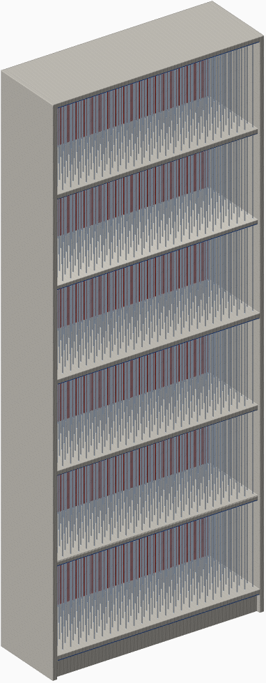 | 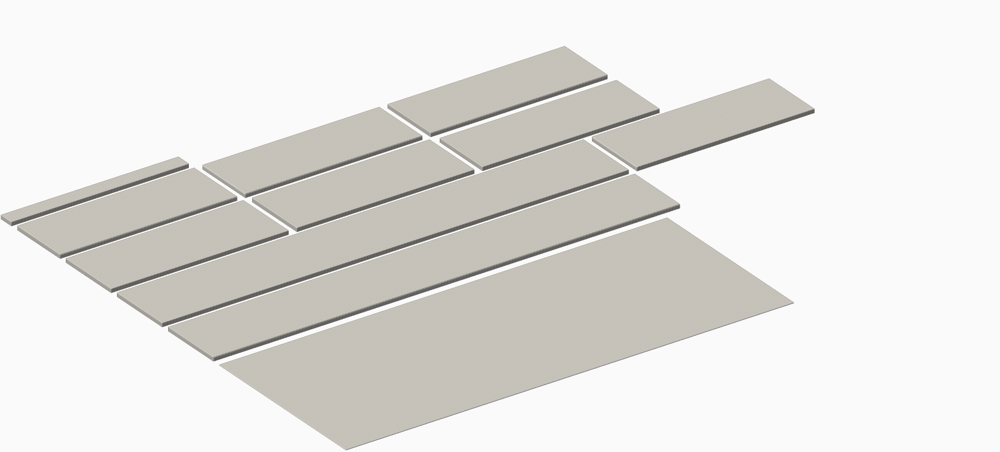 |

세워 뽑으면 선반 여섯 장이 모두 공중에 뜬다. 칸마다 서포트 기둥이 가득 차서(연파랑) 본체의 9.4배를 쓰고, 뜯어낸 자리가 선반 아랫면에 남는다. 뒤판(0.25mm)은 노즐이 그릴 수 없어 **통째로 빠진다**(빨강). 키트로 눕히면 서포트가 0이고 뒤판도 한 층(0.2mm)으로는 나온다. 다만 한 층짜리 판은 손으로 집으면 부러지는 두께라 두께 보정이 여전히 필요하다.

### 서랍장 · 의자 · 조명

| MALM 1:12 조립형 | ADDE 1:12 조립형 | ADDE 1:12 키트 | LAMPAN 1:12 |
| --- | --- | --- | --- |
| 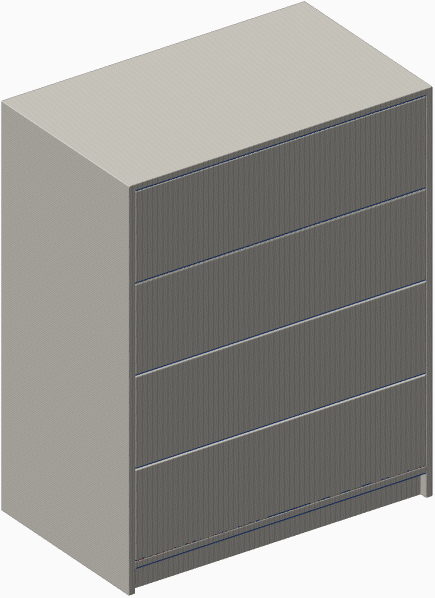 | 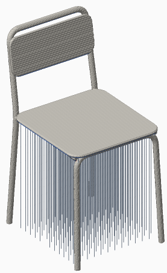 | 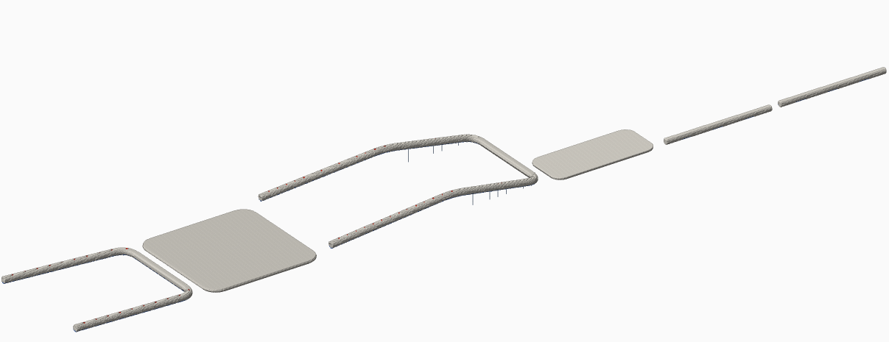 | 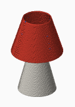 |

- **MALM**: 서랍 바닥(0.25mm)은 수평이라 한 층으로 나오지만 서포트 위에 얹힌다. 뒤판은 수직이라 빠진다.
- **ADDE**: 좌판이 다리 위에 떠 있어 서포트가 본체의 22배. 키트로 눕히면 0.2배로 줄지만, 둥근 철사 관이 바닥에 선으로만 닿아 아래에 서포트가 생기고 관 꼭대기 한 줄이 노즐 폭보다 좁아 빠진다(빨간 점). 관 바닥을 평평하게 깎는 작업(C3)이 이것을 없앤다.
- **LAMPAN**: 종이 갓은 두께가 노즐보다 얇아 **갓 전체가 사라진다**. 회전체(갓)는 경계 상자로 두께를 알 수 없어 재단표 점검에도 안 걸렸다. 갓은 두께 보정이나 "종이 전개도로 따로"가 필요하다.

### POÄNG · KLIPPAN

| POÄNG 1:12 조립형 | POÄNG 1:12 키트 | KLIPPAN 1:12 조립형 |
| --- | --- | --- |
| 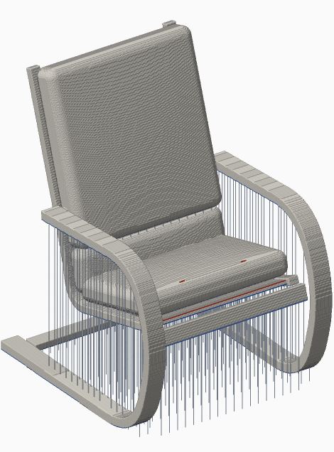 | 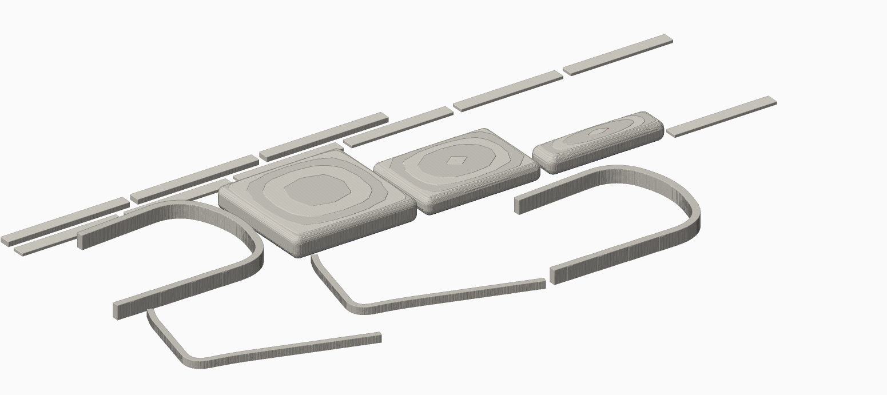 | 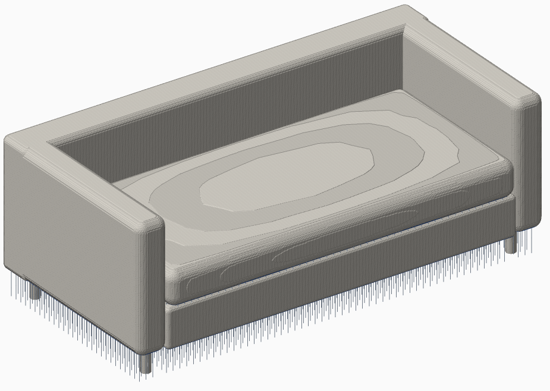 |

- **POÄNG**: 곡선 팔걸이 프레임은 판처럼 눕히면 서포트 없이 나온다(키트의 강점). 쿠션 윗면에 층 계단(등고선)이 보인다. 0.2mm 층에서 완만한 곡면은 계단이 넓게 드러나므로 쿠션은 0.12mm 층이나 사포질이 필요하다.
- **KLIPPAN**: 덩어리 가구는 세워 뽑아도 서포트가 본체의 0.3배(몸통 아래, 다리 사이)뿐이다. 소파·침대 같은 블록형은 조립형 출력이 오히려 빠르고 깔끔하다.

### 1:48 — 레진이어도 뒤판은 남지 않는다

| BILLY 1:48 FDM | BILLY 1:48 레진 | ADDE 1:24 레진 |
| --- | --- | --- |
| 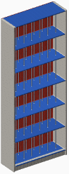 | 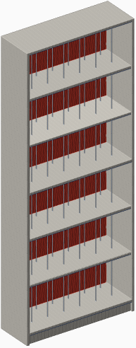 | 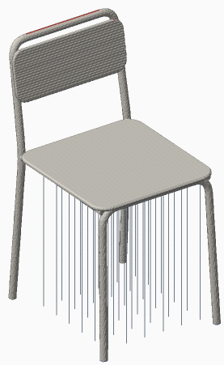 |

1:48 의 뒤판은 0.06mm 라 레진(최소 0.15mm)으로도 안 나온다. 1:24 의 ADDE 는 레진이면 형상은 다 나오지만, 세워 뽑으면 서포트가 본체의 20배다. 레진도 축척이 작아질수록 두께 보정과 출력 자세가 핵심이다.

## 5. 결론 — 무엇을 먼저 고칠까

1. **두께가 첫째다.** 실패의 대부분은 실물 3mm 판(뒤판·서랍 바닥·수납통)이 축척으로 0.25mm 가 되는 데서 온다. 출력용으로 **바깥면은 두고 안쪽으로** 두껍게 하는 변환이 필요하다(할 일 B1). 재료 맞춤(`fit`)은 목공 규격이라 대신할 수 없다. 회전체 갓처럼 경계 상자로 두께를 알 수 없는 부품은 형상에서 벽 두께를 재야 한다(B1·B3).
2. **기본은 키트, 블록형만 조립형.** 상자·의자형은 세우면 서포트가 본체의 6–22배, 눕히면 거의 0이다. 소파·침대 같은 덩어리는 조립형도 0.3배라 둘 다 권할 수 있다. 내보내기 화면이 가구 종류에 맞춰 권하게 한다(B4).
3. **둥근 부품의 자세.** 키트의 서포트·실패는 대부분 원기둥·철사 관·구슬이 굴러가는 자세에서 생긴다(가구당 평균 3.5개). 세우거나 바닥을 평평하게 깎는다(C2·C3).
4. **판 크기와 1:6.** 1:12 이하는 256mm 판이면 키트 한 장(평균 1.13장)에 들어간다. 1:6 은 큰 부품 221개를 나눠야 하므로 뒤로 미룬다(D4).
5. **시뮬레이터의 다음 할 일.** 지금 숫자는 근사다. 같은 기준으로 고친 결과를 비교하는 데는 충분하지만, 최소 형상·브리지·공차의 절대값은 실제 시편(G1)과 시범 출력(G2)으로 맞춰야 한다.

## 6. 기준 프린터와 층 높이

기준 프린터는 **가정용 FDM · 0.4mm 노즐 · 256mm 판 · PLA** 로 정했다(결정과 이유: [tasks/plan.md](../tasks/plan.md) "기준 프린터"). 1–5절의 숫자는 이 프린터의 0.2mm 층으로 뽑은 것이다. 남은 질문은 미니어처를 몇 mm 층으로 뽑느냐다.

키트는 부품을 가장 얇은 축이 위로 오게 눕히므로, 부품 두께가 층 높이의 몇 배인지가 품질을 정한다. 1:12 · 1:24 의 부품 1,762개(100종)를 층 높이별로 셈했다(재단표 두께 기준, 슬라이서처럼 층 경계로 반올림).

| 층 높이 | 1:12 한 층짜리 부품 | 1:12 두께 보정(B1) 뒤 오차 0.05mm 이상 | 1:24 한 층짜리 부품 | 출력 시간(0.2mm 대비) |
| --- | ---: | ---: | ---: | ---: |
| 0.2mm | 105 | 39% | 160 | 1 |
| 0.16mm | 6 | 45% | 139 | 1.25 |
| **0.12mm** | **0** | **12%** | 125 | 1.67 |
| 0.08mm | 0 | 0% | 6 | 2.5 |

- 눕혀 뽑으면 1:12 · 1:24 모두 사라지는 부품은 없다(가장 얇은 부품이 1:12 0.21mm · 1:24 0.1mm 로, 0.2mm 층의 절반 이상). 문제는 **한 층짜리**다. 0.2mm 층에서는 1:12 뒤판·서랍 바닥 105개가 0.2mm 한 장으로 나와 떼다가 찢어진다.
- 0.12mm 층이면 1:12 에서 한 층짜리가 0개가 되고, 두께 오차도 크게 줄어든다. 시간은 약 1.7배(같은 부피를 더 많은 층으로 나누므로 층 수에 비례하는 근사).
- 그래서 미니어처의 기본 층은 **0.12mm**, 0.2mm 는 "빠르게"로 둔다. 1:24 는 0.12mm 로도 125개가 한 층이라 두께 보정(B1)이 반드시 필요하다.
- 두께 보정(B1)은 두께를 **층 높이의 정수배로 올리면** 슬라이서 반올림 오차가 없어진다(할 일 B1 에 추가).

같은 키트를 두 층 높이로 시뮬레이션했다(실제 부품 부피: BILLY 27,030mm³ · POÄNG 37,000mm³).

| 키트 1:12 | 층 수 | 찍히는 부피(실제 대비) | 서포트 | 필라멘트 |
| --- | ---: | ---: | ---: | ---: |
| BILLY 0.2mm | 7 | 27,730mm³ (+2.6%) | 0 | 10.8g |
| BILLY 0.12mm | 12 | 26,697mm³ (−1.2%) | 0 | 10.4g |
| POÄNG 0.2mm | 45 | 37,026mm³ (+0.1%) | 48mm³ | 18.3g |
| POÄNG 0.12mm | 74 | 36,963mm³ (−0.1%) | 72mm³ | 18.3g |

얇은 판이 많은 BILLY 는 층 높이에 따라 찍히는 부피가 실제 대비 +2.6% 와 −1.2% 로 갈린다. 두꺼운 부품이 많은 POÄNG 은 거의 같다. 둘 다 서포트·안 나오는 부분은 층 높이와 관계없이 그대로다. 그림: [BILLY 0.12mm](print-sim/billy-1x12-kit-fdmFine.png) · [POÄNG 0.12mm](print-sim/poang-1x12-kit-fdmFine.png).

다시 돌리기: `node tools/print-sim.mjs render billy 12 kit fdmFine`.

## 7. 출력용 두께 보정(B1) 뒤

내보내기 STL 은 이제 원래 모델이 아니라 `printModel()` 이 만든 출력용 모델을 쓴다(얇은 판·각재를 바깥면은 두고 안쪽으로 층의 정수배까지 두껍게, 기준 프린터 0.12mm 층이면 0.84mm). sweep 의 `printLost`·`printWeak` 열이 이 모델로 다시 센 값이다.

| 항목 | 1:6 | 1:12 | 1:18 | 1:24 | 1:48 |
| --- | ---: | ---: | ---: | ---: | ---: |
| FDM 사라지는 부품 없음 % (원래 → 출력용) | 100 → 100 | 72 → **100** | 66 → 97 | 63 → **95** | 40 → 82 |
| FDM 0.8mm 미만 없음 % (원래 → 출력용) | 68 → 99 | 59 → 93 | 40 → 82 | 25 → 71 | 11 → 54 |

표의 출력용 값은 B1 직후다. B2(봉·철사·구슬을 지름 1.0mm 로) 뒤에는 1:6–1:24 모두 사라짐 없음·0.8mm 미만 없음이 100%, 1:48 은 100% · 98% 다. B3 은 투명판(유리·거울)을 출력에서 빼고 DXF 로 돌리며, 얇은 벽 회전체(갓·컵·싱크볼·트레이)는 단면에서 가장 얇은 벽을 재어 안쪽으로 0.84mm 까지 키운다. LAMPAN 1:12 조립형 출력용은 안 나옴 10.6% → 0% 다(`render lampan 12 assembled fdm print`).

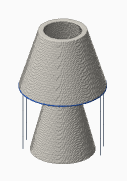

BILLY 1:12 조립형을 출력용 모델로 다시 뽑으면 안 나옴이 9.6% → 0% 다(뒤판이 산다). 서포트는 본체의 6.8배로 여전히 많아, 상자형은 키트가 기본이다. 다시 뽑기: `node tools/print-sim.mjs render billy 12 assembled fdm print`.

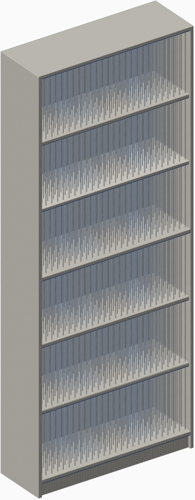

**두께·지름을 키워 생긴 겹침**(B1–B3 뒤, `node tools/print-sim.mjs overlaps` → [thicken-overlaps.json](print-sim/thicken-overlaps.json)): 1:12 에서 206개 부품을 키워 새 겹침 319쌍(38종, 측판↔뒤판 42 · 서랍 앞판↔옆판 24 · 바닥판↔뒤판 18), 1:24 에서 1,048개 → 1,832쌍(72종, 서랍 옆판↔뒤판·바닥 각 108). 겹친 껍질은 슬라이서가 합쳐 주므로 조립형 출력에는 문제가 없지만, 키트는 부품끼리 끼울 자리가 줄어든다. 경계 상자 기준이라 과대 추정이고, 접촉 그래프(D1)가 맞닿는 면을 피해 키우게 한다.

## 8. 출력 점검 보고(B4)와 확인 지점 B

내보내기 탭이 고른 프린터·층 높이로 "출력 점검"을 보여 준다. 계산은 `printReport()` 하나이고 sweep 이 같은 함수를 쓴다(`printFit256` · `printPlates` · `printGrams` · `printFill` · `recommend` 열).

| 1:N (기준 프린터 0.12mm 층, 출력용 모델) | 1:6 | 1:12 | 1:18 | 1:24 | 1:48 |
| --- | ---: | ---: | ---: | ---: | ---: |
| 사라지는 부품 없음 % | 100 | **100** | 100 | **100** | 100 |
| 0.8mm 미만 없음 % | 100 | 100 | 100 | 100 | 98 |
| 키트 판 수(평균) | 2.07 | 1.13 | 1.01 | 1 | 1 |
| 필라멘트 g(평균, 서포트 제외) | 264 | 43 | 15 | 7.3 | 1.5 |
| 조립형도 권하는 가구 | 11 | 12 | 12 | 14 | 26 |

- **권하는 방식**: 채움비(부품 부피 ÷ 바깥 상자 부피)가 0.4 이상이면 완성형·키트 둘 다, 아니면 키트. 1:12 에서 소파 9종 · MOPPE · LACK 벽선반 · FADO 가 0.45–1.0, 상자·의자·책장은 0.32 이하, 침대는 틀이라 0.01–0.06 이다. 작은 축척일수록 두께 보정으로 부품이 굵어져 덩어리가 많아진다.
- **필라멘트**: 부품마다 겉 벽 0.8mm 는 꽉, 그 안은 25% 로 센다. BILLY 1:12 키트 41g. 시뮬레이터(4절·6절의 10–11g)는 층 단면의 수평 벽만 꽉 차게 보고 눕힌 얇은 판의 위·아래 막을 25% 로 세서 적게 나온다. 슬라이서는 위·아래 막을 3–5층 꽉 채우므로 보고 쪽이 실제에 가깝다고 보지만, 시범 출력(G2)의 무게로 확인해야 한다.

**확인 지점 B** 의 sweep 기준(1:12 FDM 100%, 1:24 95% 이상)은 출력용 모델에서 둘 다 100% 로 넘었다. 남은 것은 시범 출력 1(BILLY 1:12 키트)이다.
